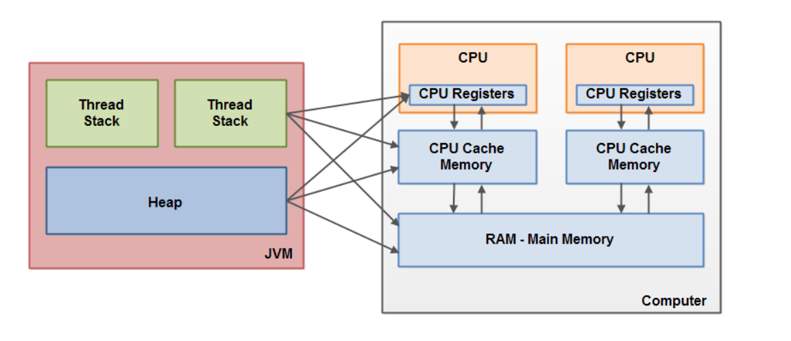

### Q1 Features of Java
   1. Object oriented -> It supports classes and objects
   2. Platform independent -> write once run anywhere
   3. Robust & Secure → Strong type checking, garbage collection, no explicit pointers
   4. Multithreaded → Built-in thread support.
   5. Portable → Bytecode runs on any JVM.
   6. High Performance → JIT compiler optimizes execution
   
### Q2 Difference between == and .equals()
   == check if two references point to the same object where as .equals checks if the two references are equal in content

### Q3 Difference between abstract class and interface

    | Feature               | Abstract Class | Interface         |
    |-----------------------|----------------|-------------------|
    | Code reuse            | ✅ Yes         | ❌ No             |
    | Holds state           | ✅ Yes         | ❌ No             |
    | Multiple inheritance  | ❌ No          | ✅ Yes            |
    | Constructors          | ✅ Yes         | ❌ No             |
    | Default methods       | ✅ Yes         | ✅ (Java 8+)      |

### Q4 Difference between final, finally, and finalize()

        | Keyword     | Type     | Purpose                                                                                |
        |-------------|----------|---------------------------------------------                                           |
        | `final`     | Modifier | Prevents changes: marks variables as constants, methods as non-overridable, classes as non-extendable |
        | `finally`   | Block    | Ensures cleanup code runs always, whether an exception is thrown or not |
        | `finalize()`| Method   | Called by the Garbage Collector before object destruction (deprecated since Java 9) |

### Q5 Explain collections heirarchy

                        Iterable
                            ^
                            |
                            |
                        Collection
                            ^
                            |
                            |
            ----------------------------------------
            ^               ^                       ^
            |               |                       |
            |               |                       |
           List           Queue                    Set<-------------
            ^               ^ ^                     ^               '
            '               | '                     |               '-hashset
            '-arraylist     | priority queue        |               '
            '               Deque                   |               '
            '-linkedlist----^                    Sorted Set         '-linked hashset
            '               '                       ^
            '-vector        '                       '
                ^           ArrayDeque              '
                |                                 Tree Set
              stack

### Q6 Difference between hashmap, hashtable and concurrent hashmap

| Feature                   | HashMap               | Hashtable              | ConcurrentHashMap         |
|---------------------------|-----------------------|------------------------|----------------------------|
| Thread Safety             | ❌ Not synchronized    | ✅ Fully synchronized   | ✅ Concurrent-safe         |
| Performance (multi-threaded) | ⚡ Fast (single-threaded) | 🐢 Slow (locks entire map) | ⚡⚡ Fast (fine-grained locking) |
| Null Keys/Values          | ✅ Allows one null key and multiple null values | ❌ No null keys/values | ❌ No null keys/values     |
| Legacy Status             | ✅ Modern              | ❌ Legacy (pre-Java 1.2)| ✅ Modern (Java 5+)        |

### Q7 Difference Between ArrayList and LinkedList

| Feature                     | ArrayList                          | LinkedList                          |
|-----------------------------|-------------------------------------|--------------------------------------|
| Internal Structure          | Dynamic array                      | Doubly linked list                   |
| Access Time (get/index)     | ✅ Fast (O(1))                      | ❌ Slow (O(n))                       |
| Insert/Delete (middle)      | ❌ Slow (shifting required)         | ✅ Fast (no shifting)                |
| Memory Usage                | ✅ Compact (array overhead only)    | ❌ Higher (node objects + pointers)  |
| Iteration Performance       | ✅ Better cache locality            | ❌ Slower due to pointer chasing     |
| Use Case                    | Best for frequent access by index  | Best for frequent insert/delete ops  |

### Q8 Difference Between Checked and Unchecked Exceptions

| Feature                    | Checked Exception                     | Unchecked Exception                   |
|----------------------------|----------------------------------------|----------------------------------------|
| Package                   | `java.lang.Exception` (excluding `RuntimeException`) | `java.lang.RuntimeException` and its subclasses |
| Compile-Time Enforcement  | ✅ Must be declared or handled         | ❌ Not required to be declared or caught |
| Typical Use Cases         | File I/O, SQL, network operations      | Null pointer, array index out of bounds, illegal arguments |
| Handling Requirement      | Mandatory `try-catch` or `throws`     | Optional handling                      |
| Examples                  | `IOException`, `SQLException`         | `NullPointerException`, `IllegalArgumentException` |

---

## Q9 Difference Between `throw` and `throws` in Java

| Feature               | `throw`                                | `throws`                                 |
|-----------------------|-----------------------------------------|-------------------------------------------|
| Purpose               | Used to **explicitly throw** an exception | Used to **declare** that a method may throw an exception |
| Usage Location        | Inside method body                      | In method signature                        |
| Followed By           | An instance of `Throwable` (e.g., `new Exception()`) | One or more exception class names         |
| Control Flow Impact   | Immediately terminates execution and jumps to nearest catch block | Alerts caller to handle or propagate exception |
| Example               | `throw new IOException("File not found");` | `public void readFile() throws IOException` |

---

## Q10 What are functional interfaces

A Functional Interface in Java 8 is an interface that has exactly one abstract method.  
It represents a single functionality that can be used as a Lambda Expression or Method Reference.  
Java provides many built-in functional interfaces under java.util.function like:  
1. Predicate<T> → returns boolean
2. Function<T, R> → transforms input to output
3. Consumer<T> → takes input and performs an action
4. Supplier<T> → returns a value without input  

Example:  

    @FunctionalInterface  
    interface Greeting {  
        void sayHello();  
    }  
  
  
And we can implement it as:  

Greeting g = () -> System.out.println("Hello!");
g.sayHello();

## Q11 Difference between Stream API and Collections API

Collections are used to store and manage data, while Streams are used to process data in a functional style.  
Collections are eager — they store all elements in memory.  
Streams are lazy — they process elements on-demand through a pipeline of operations like filter, map, and reduce.  
Also, Streams don’t modify the original data; they return a new stream.  
Streams can even run parallel operations easily, improving performance on large datasets.  

## Q12 What is Optional Class in Java

Optional is a container object introduced in Java 8 to handle null values safely and avoid NullPointerException.  
Instead of returning null, methods can return an Optional<T>.  
It provides methods like isPresent(), orElse(), and ifPresent() to safely handle values.  

## Q13 How does Synchronization work in Java

Synchronization is Java’s way of controlling access to shared resources in multi-threaded environments. It ensures that only one thread can access a block of code or object at a time—preventing race conditions, data corruption, and inconsistent states.  

example:  

    class Counter {  
    
        private int count = 0;  

        public synchronized void increment() {  
            count++;  
        }  

        public synchronized int getCount() {  
            return count;  
        }  
    }  

## Q14 Difference between Volatile and Synchronized Keyword

volatile ensures that all threads see the latest value of a variable (visibility),  
whereas synchronized ensures that only one thread accesses a resource at a time (atomicity + visibility).

| Feature       | `volatile`                            | `synchronized`                                 |
|---------------|----------------------------------------|------------------------------------------------|
| **Type**      | Keyword for variables                  | Keyword for methods/blocks                     |
| **Ensures**   | Visibility only                        | Visibility + Atomicity                         |
| **Locks used**| No                                     | Yes (object/class lock)                        |
| **Performance**| Faster                                | Slower (due to locking overhead)               |
| **Use case**  | Flags, status variables                | Critical sections, shared mutable state        |
| **Example**   | `volatile boolean isRunning;`          | `synchronized void update() { ... }`           |

## Q15 What is Garbage Collection (GC)?

Garbage Collection in Java is the automatic process of reclaiming memory used by objects that are no longer reachable (i.e., no active reference is pointing to them).  

✅ Without GC, developers would need to manually free memory (like in C/C++ using free() or delete).  
✅ With GC, Java automatically detects and removes unused objects from the heap memory.  

Heap Memory:  
  ├── Young Generation  
  │     ├── Eden Space  
  │     └── Survivor Spaces (S0, S1)  
  └── Old Generation  

#### 🧹 Java Garbage Collection (GC) Process

#### 📦 Object Creation
- New objects are allocated in **Eden Space** (Young Generation).

#### 🔄 Minor GC
- Triggered when Eden fills up.
- **Unreachable objects** are discarded.
- **Survivors** move to **Survivor Spaces**.
- After several cycles, long-lived objects are **promoted to Old Generation**.

#### 🧼 Major GC
- Triggered when **Old Generation** fills up.
- Cleans up **long-lived unreachable objects**.
- Typically **slower** than Minor GC.

**By reachability analysis — if no live thread or static reference can reach an object, it's considered garbage.**

## Q16 Explain Java Memory Model

| Memory Area             | Stores                                   | Created              | Destroyed           | Thread Scope             |
| ----------------------- | ---------------------------------------- | -------------------- | ------------------- | ------------------------ |
| **Heap**                | Objects, instance variables              | When JVM starts      | On GC               | Shared among all threads |
| **Stack**               | Local variables, method calls            | When thread starts   | When thread ends    | Per thread               |
| **Metaspace**           | Class metadata, method info              | When class is loaded | When class unloaded | Shared                   |
| **PC Register**         | Address of current executing instruction | Thread start         | Thread end          | Per thread               |
| **Native Method Stack** | Native (C/C++) method calls              | Thread start         | Thread end          | Per thread               |

## Q17 Explain spring vs spring boot

🧩 1. What is Spring Framework?

Spring Framework is a comprehensive Java framework for building enterprise applications.
It provides features like:

Dependency Injection (DI)

Aspect-Oriented Programming (AOP)

Transaction Management

Spring MVC (web framework)

Integration with ORM tools (Hibernate, JPA)

But… it required a lot of XML configuration and manual setup (like web.xml, dispatcher-servlet.xml, etc.)

⚡ 2. What is Spring Boot?

Spring Boot is a layer built on top of Spring that makes application development faster and easier.

It provides:

Auto-configuration 🧠

Embedded servers (Tomcat, Jetty) 🧱

Starter dependencies ⚙️

Production-ready tools (Actuator, Metrics) 🚀

👉 In short: Spring Boot = Spring Framework + Automation + Defaults + Simplicity.
| Feature            | Spring Framework                     | Spring Boot                              |
| ------------------ | ------------------------------------ | ---------------------------------------- |
| **Setup**          | Requires manual XML/Java config      | Auto-configured setup                    |
| **Server**         | Needs external server (Tomcat/Jetty) | Embedded Tomcat/Jetty                    |
| **Dependencies**   | Must manage versions manually        | Uses “Starters” for grouped dependencies |
| **Configuration**  | Annotation/XML heavy                 | Minimal; uses `application.properties`   |
| **Deployment**     | WAR file deployment                  | Can run directly as JAR (`java -jar`)    |
| **Monitoring**     | Needs manual setup                   | Built-in via Spring Boot Actuator        |
| **Learning Curve** | Steeper                              | Easier for beginners and microservices   |

## Q18 What Are Spring Boot Starters?

🧩 Definition

Spring Boot Starters are predefined dependency bundles provided by Spring Boot to simplify project setup.

Instead of manually adding 10–15 individual dependencies,
you just include one starter, and Spring Boot automatically pulls in everything required.

Example:  

    Let’s say you want to build a Spring Boot REST API.

    Normally (in traditional Spring), you’d add dependencies like:

    spring-core  
    spring-web  
    spring-context  
    jackson-databind  
    servlet-api

    😩 That’s tedious and version-conflict prone.

    With Spring Boot, you just add:

    <dependency>
    <groupId>org.springframework.boot</groupId>
    <artifactId>spring-boot-starter-web</artifactId>
    </dependency>

    ✅ Done — it automatically adds:

    spring-boot-starter-web
        ├── spring-web
        │   ├── spring-webmvc
        │   └── spring-websocket
        ├── jackson-databind
        ├── tomcat-embed-core
        └── validation-api

## Q19 Explain Dependency Injection and Inversion Of Control

Inversion of Control (IoC) means:  
The control of object creation and their dependencies is given to a container or framework, not your code.

Dependency Injection is a way to implement IoC. It means:  
Instead of a class creating its own dependencies, they are injected by the container.

IoC Container:  
Spring provides two main IoC Containers.  
BeanFactory — basic container.  
ApplicationContext — advanced container with features like event handling, AOP, and internationalization.  

"Spring uses IoC to manage object creation and lifecycle. I declare dependencies via DI, and the container wires them in. The ApplicationContext is the heart of this system—it scans, instantiates, and injects beans based on configuration or annotations."